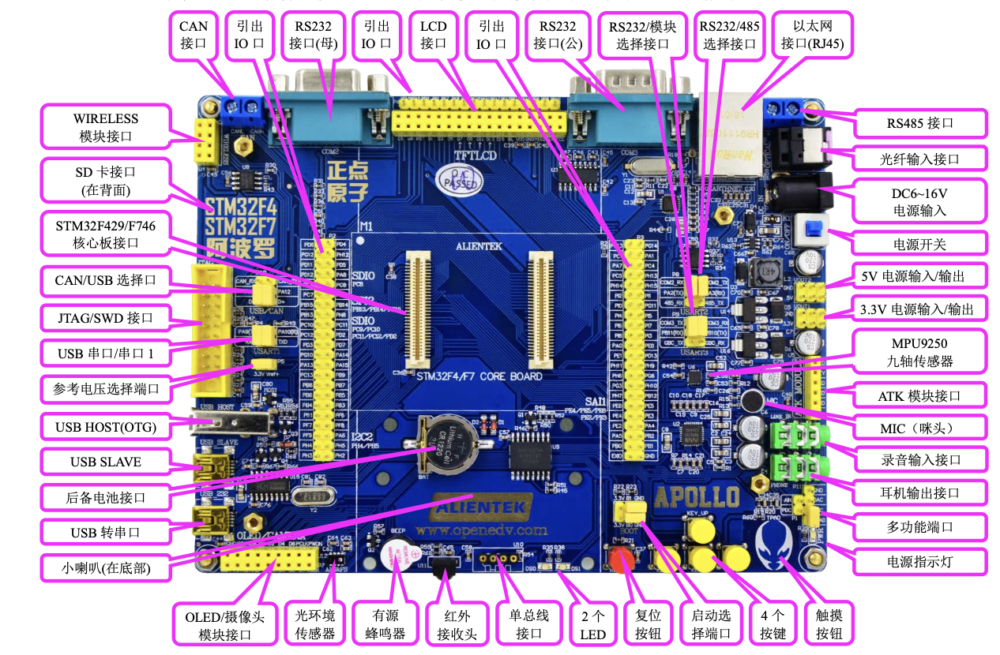
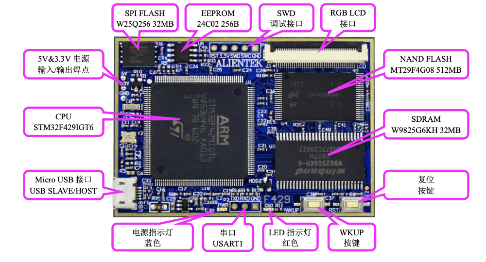
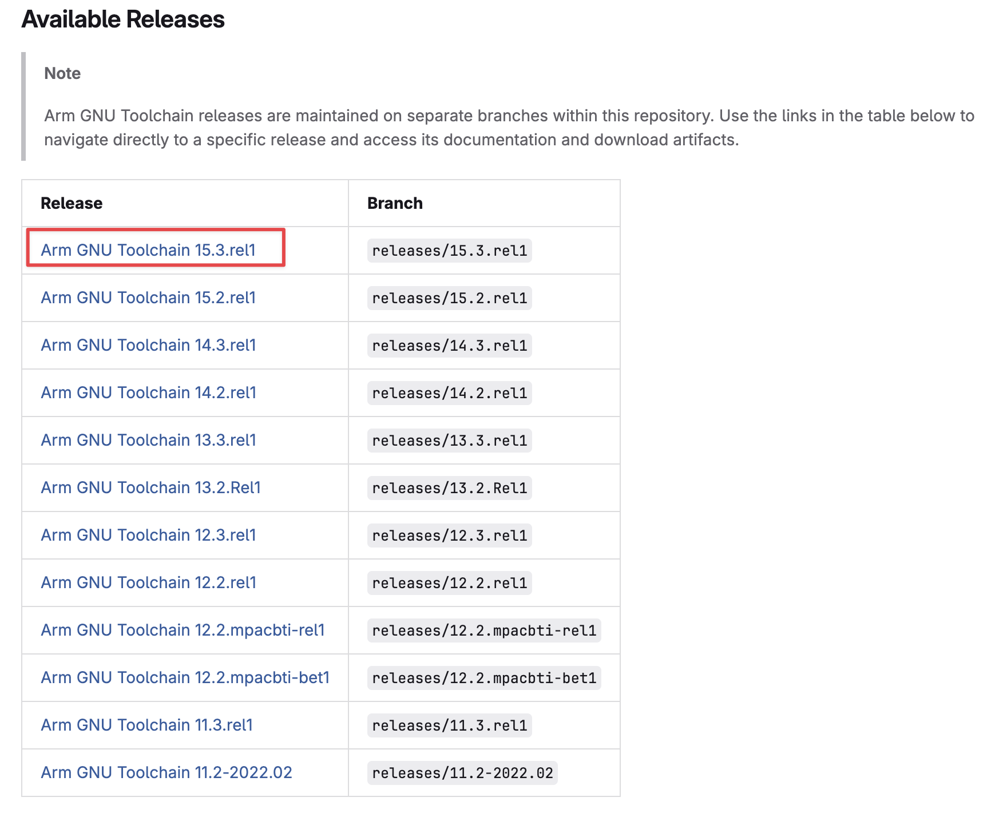
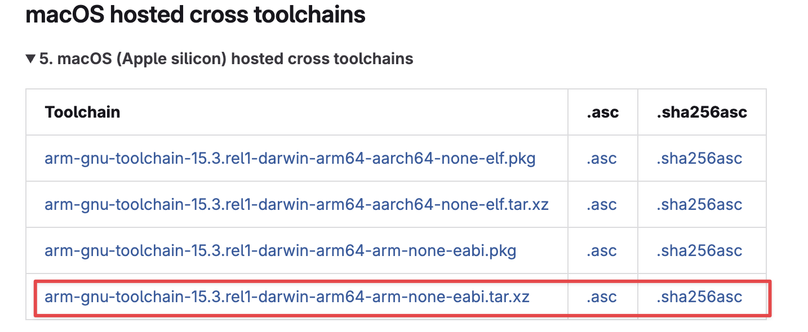

# MacOS与CMake搭建STM32F4纯净基础骨架

GitHub仓库地址：https://github.com/DavidRedVest/STM32F429_ThreadX_Demo

开发环境

- macbook pro m4电脑
- VSCode软件
- STM32CubeF4库
- 交叉编译链
- STM32F429IGT6芯片


硬件资源：正点原子阿波罗STM32F429开发板

 


 

硬件资源：

- STM32F429IGT6 

- 晶振 25MHZ

- 1M Flash
- 256K SRAM
- 主频180MHZ
- Cortex-M4F内核
- ARMv7e-M架构


# 下载HAL库 

从`GitHub`下载`STM32CubeF4`代码库：https://github.com/STMicroelectronics/STM32CubeF4

目前最新tags版本是v1.28.3

```she
git clone https://github.com/STMicroelectronics/STM32CubeF4
cd STM32CubeF4
git checkout tags/v1.28.3
git submodule update --init --recursive
```

# 安装交叉编译链 

下载`arm-none-eabe-gcc`交叉编译链：https://gitlab.arm.com/tooling/gnu-toolchains-for-arm 

目前最新版本`15.3`

 

对于`macbook pro m4`电脑，下载链接：https://gitlab.arm.com/tooling/gnu-toolchains-for-arm/-/tree/releases/15.3.rel1?ref_type=heads#macos 

选择`arm-gnu-toolchain-15.3.rel1-darwin-arm64-arm-none-eabi.tar.xz`下载

 


下载之后，解压，并修改`~/.zshrc`文件（没有就创建），我的实际解压目录：`/Users/liszt/Document/tools/`，增加内容如下：

```she
export PATH="/Users/liszt/Document/tools/arm-gnu-toolchain-15.3.rel1-darwin-arm64-arm-none-eabi/bin:$PATH"
```

修改之后生效：

```she
source ~/.zshrc 
```

在终端检查版本：

```she
liszt@FranzdeMBP STM32CubeF4 % arm-none-eabi-gcc --version
arm-none-eabi-gcc (Arm GNU Toolchain 15.3.Rel1 (Build arm-15.149)) 15.3.1 20260627
Copyright (C) 2025 Free Software Foundation, Inc.
This is free software; see the source for copying conditions.  There is NO
warranty; not even for MERCHANTABILITY or FITNESS FOR A PARTICULAR PURPOSE.
```

能正常打印出版本即可。

# 创建工程 

创建出一个工程模版如下

```tex
stm32f429_template/
├── CMakeLists.txt              # 1. 顶层根构建入口（负责全局选项、定义目标与子模块装配）
├── cmake/                      # 2. CMake 支撑脚本目录
│   ├── arm-none-eabi.cmake     # 交叉编译工具链定义（Toolchain File）
│   └── STM32F429IGTx_FLASH.ld  # 链接脚本（推荐集中放置在 cmake/ 目录下）
│
├── drivers/
│   ├── CMakeLists.txt          # [可选] Drivers 子模块构建脚本（生成 DriversTarget 静态库/接口）
│   ├── cminc/
│   └── src/
│   └── inc/
├── bsp/
│   ├── CMakeLists.txt          # [可选] BSP 子模块构建脚本
│   ├── inc/
│   └── src/
├── middlewares/
│   └── threadx/
│       └── CMakeLists.txt      # ThreadX 内核构建脚本
├── app/
│   ├── CMakeLists.txt          # [可选] App 业务逻辑构建脚本
│   ├── inc/
│   └── src/
└── core/
		├── CMakeLists.txt
    ├── inc/
    └── src/
```


# 移植STM32CubeF4库 

## drivers/cminc 

存放 `STM32CubeH5\Drivers\CMSIS\Include\` 路径下的头文件：

- `core_cm4.h`：cortex-m4核心寄存器与NVIC访问定义
- `cmsis_version.h`：CMSIS规范版本定义
- `cmsis_compiler.h`：编译器统一抽象入口
- `cmsis_gcc.h`：GCC平台专用的内联汇编与内置函数
- `mpu_armv7.h`：ARMv7-M 内存保护单元（MPU）寄存器映射与 API

## drivers/inc 

存放 `STM32CubeF4/Drivers/STM32F4xx_HAL_Driver/Inc` 路径下的文件（去掉Legacy文件夹内容，`stm32_assert_template.h`，`stm32f4xx_hal_conf_template.h`）

## drivers/src 

存放 `STM32CubeF4/Drivers/STM32F4xx_HAL_Driver/Src` 路径下的文件（去掉带template命名的文件，如`stm32f4xx_hal_msp_template.c`，`stm32f4xx_hal_timebase_rtc_alarm_template.c`，`stm32f4xx_hal_timebase_rtc_wakeup_template.c`，`stm32f4xx_hal_timebase_tim_template.c`）

## core/src 

存放 `STM32CubeF4/Drivers/CMSIS/Device/ST/STM32F4xx/Source/Templates` 路径下的 `system_stm32f4xx.c` 文件。

存放 `STM32CubeF4/Drivers/CMSIS/Device/ST/STM32F4xx/Source/Templates/gcc` 路径下的 `startup_stm32f429xx.s` 文件，并将后缀小写`.s`改为大写`.S` 

存放 `STM32CubeF4/Projects/STM32F429I-Discovery/Templates/Src` 路径下的 `main.c`，`system_stm32f4xx.c`，`stm32f4xx_it.c`，`stm32f4xx_hal_msp.c` 文件，其中`main.c`文件只保留`HAL_Init()`

和`SystemClock_Config()` 初始化代码，其它功能代码去掉。

## core/inc

存放 `STM32CubeF4/Drivers/CMSIS/Device/ST/STM32F4xx/Include` 路径下的`system_stm32f4xx.h`，`stm32f4xx.h`，`stm32f429xx.h` 文件

存放 `STM32CubeF4/Projects/STM32F429I-Discovery/Templates/Inc` 路径下的 `main.h`，`stm32f4xx_it.h`，`stm32f4xx_hal_conf.h` 文件。

## cmake 

存放 `STM32CubeF4/Projects/STM32F429I-Discovery/Templates/STM32CubeIDE` 路径下`STM32F429ZITX_FLASH.ld` 文件，并改名为 `STM32F429IGT6_FLASH.ld` 文件名，修改内容如下：

```C
/* Memories definition */
MEMORY
{
  CCMRAM    (xrw)    : ORIGIN = 0x10000000,   LENGTH = 64K
  RAM    (xrw)    : ORIGIN = 0x20000000,   LENGTH = 192K
  ROM    (rx)    : ORIGIN = 0x08000000,   LENGTH = 1024K
}
```

实际芯片FLASH为1M，将上述内容中的ROM所在行`LENGTH = 2048K`改为`LENGTH = 1024K` 

## 修改时钟频率 

开发板硬件晶振是`25MHZ`，但是HAL库中默认是`8MHZ`，需要修改，也就是`main.c`中的`SystemClock_Config`函数初始化部分需要修改，时钟初始化为180MHZ.

```C
static void SystemClock_Config(void)
{
  HAL_StatusTypeDef ret = HAL_OK;
  RCC_OscInitTypeDef RCC_OscInitStructure;
  RCC_ClkInitTypeDef RCC_ClkInitStructure;

  __HAL_RCC_PWR_CLK_ENABLE(); // 使能PWR时钟

  // 下面这个设置用来设置调压器输出电压级别，以便在器件未以最大频率工作
  // 时使性能与功耗实现平衡，此功能只有STM32F42xx和STM32F43xx器件有，
  __HAL_PWR_VOLTAGESCALING_CONFIG(PWR_REGULATOR_VOLTAGE_SCALE1); // 设置调压器输出电压级别1

  RCC_OscInitStructure.OscillatorType = RCC_OSCILLATORTYPE_HSE; // 时钟源为HSE
  RCC_OscInitStructure.HSEState = RCC_HSE_ON;                   // 打开HSE
  RCC_OscInitStructure.PLL.PLLState = RCC_PLL_ON;               // 打开PLL
  RCC_OscInitStructure.PLL.PLLSource = RCC_PLLSOURCE_HSE;       // PLL时钟源选择HSE
  RCC_OscInitStructure.PLL.PLLM = 25;                           // 主PLL和音频PLL分频系数(PLL之前的分频),取值范围:2~63.
  RCC_OscInitStructure.PLL.PLLN = 360;                          // 主PLL倍频系数(PLL倍频),取值范围:64~432.
  RCC_OscInitStructure.PLL.PLLP = 2;                            // 系统时钟的主PLL分频系数(PLL之后的分频),取值范围:2,4,6,8.(仅限这4个值!)
  RCC_OscInitStructure.PLL.PLLQ = 8;                            // USB/SDIO/随机数产生器等的主PLL分频系数(PLL之后的分频),取值范围:2~15.
  ret = HAL_RCC_OscConfig(&RCC_OscInitStructure);               // 初始化

  if (ret != HAL_OK)
    while (1)
      ;

  ret = HAL_PWREx_EnableOverDrive(); // 开启Over-Driver功能
  if (ret != HAL_OK)
    while (1)
      ;

  // 选中PLL作为系统时钟源并且配置HCLK,PCLK1和PCLK2
  RCC_ClkInitStructure.ClockType = (RCC_CLOCKTYPE_SYSCLK | RCC_CLOCKTYPE_HCLK | RCC_CLOCKTYPE_PCLK1 | RCC_CLOCKTYPE_PCLK2);
  RCC_ClkInitStructure.SYSCLKSource = RCC_SYSCLKSOURCE_PLLCLK;       // 设置系统时钟时钟源为PLL
  RCC_ClkInitStructure.AHBCLKDivider = RCC_SYSCLK_DIV1;              // AHB分频系数为1
  RCC_ClkInitStructure.APB1CLKDivider = RCC_HCLK_DIV4;               // APB1分频系数为4
  RCC_ClkInitStructure.APB2CLKDivider = RCC_HCLK_DIV2;               // APB2分频系数为2
  ret = HAL_RCC_ClockConfig(&RCC_ClkInitStructure, FLASH_LATENCY_5); // 同时设置FLASH延时周期为5WS，也就是6个CPU周期。

  if (ret != HAL_OK)
    while (1)
      ;
}

```


> 注意，这里需要优化时钟频率，为了保证USB时钟是48MHZ，这里主频设置为168MHZ最合理

优化时钟为168MHZ

```C
static void SystemClock_Config(void)
{
  HAL_StatusTypeDef ret = HAL_OK;
  RCC_OscInitTypeDef RCC_OscInitStructure;
  RCC_ClkInitTypeDef RCC_ClkInitStructure;

  __HAL_RCC_PWR_CLK_ENABLE(); // 使能PWR时钟

  // 下面这个设置用来设置调压器输出电压级别，以便在器件未以最大频率工作
  // 时使性能与功耗实现平衡，此功能只有STM32F42xx和STM32F43xx器件有，
  __HAL_PWR_VOLTAGESCALING_CONFIG(PWR_REGULATOR_VOLTAGE_SCALE1); // 设置调压器输出电压级别1

  RCC_OscInitStructure.OscillatorType = RCC_OSCILLATORTYPE_HSE; // 时钟源为HSE
  RCC_OscInitStructure.HSEState = RCC_HSE_ON;                   // 打开HSE
  RCC_OscInitStructure.PLL.PLLState = RCC_PLL_ON;               // 打开PLL
  RCC_OscInitStructure.PLL.PLLSource = RCC_PLLSOURCE_HSE;       // PLL时钟源选择HSE
  RCC_OscInitStructure.PLL.PLLM = 25;                           // 主PLL和音频PLL分频系数(PLL之前的分频),取值范围:2~63.
  RCC_OscInitStructure.PLL.PLLN = 336;                          // 主PLL倍频系数(PLL倍频),取值范围:64~432. (336 而不是 360，为了让 PLLQ 能整除出精确 48MHz)
  RCC_OscInitStructure.PLL.PLLP = 2;                            // 系统时钟的主PLL分频系数(PLL之后的分频),取值范围:2,4,6,8.(仅限这4个值!)
  RCC_OscInitStructure.PLL.PLLQ = 7;                            // USB/SDIO/随机数产生器等的主PLL分频系数(PLL之后的分频),取值范围:2~15. 336/7=48MHz，标准值
  ret = HAL_RCC_OscConfig(&RCC_OscInitStructure);               // 初始化

  if (ret != HAL_OK)
    Error_Handler();

  ret = HAL_PWREx_EnableOverDrive(); // 开启Over-Driver功能 (168MHz本身不强制需要，但开着无害，>168MHz时才是必须的)
  if (ret != HAL_OK)
    Error_Handler();

  // 选中PLL作为系统时钟源并且配置HCLK,PCLK1和PCLK2
  RCC_ClkInitStructure.ClockType = (RCC_CLOCKTYPE_SYSCLK | RCC_CLOCKTYPE_HCLK | RCC_CLOCKTYPE_PCLK1 | RCC_CLOCKTYPE_PCLK2);
  RCC_ClkInitStructure.SYSCLKSource = RCC_SYSCLKSOURCE_PLLCLK;       // 设置系统时钟时钟源为PLL
  RCC_ClkInitStructure.AHBCLKDivider = RCC_SYSCLK_DIV1;              // AHB分频系数为1
  RCC_ClkInitStructure.APB1CLKDivider = RCC_HCLK_DIV4;               // APB1分频系数为4
  RCC_ClkInitStructure.APB2CLKDivider = RCC_HCLK_DIV2;               // APB2分频系数为2
  ret = HAL_RCC_ClockConfig(&RCC_ClkInitStructure, FLASH_LATENCY_5); // 同时设置FLASH延时周期为5WS，也就是6个CPU周期。

  if (ret != HAL_OK)
    Error_Handler();
}
```


## 去掉不需要的头文件 

找到 `drivers/inc/stm32f4xx_hal_def.h` 文件，去掉头文件引用`#include "Legacy/stm32_hal_legacy.h"`


## 修改晶振频率 

找到 `stm32f4xx_hal_conf.h` 文件，找到`HSE_VALUE`的定义，将默认的`8MHZ`改为`25MHZ` 

```C
#if !defined  (HSE_VALUE)
  #define HSE_VALUE    (25000000U) /*!< Value of the External oscillator in Hz (this board's HSE crystal is 25MHz, not ST's default 8MHz template value) */
#endif /* HSE_VALUE */
```

不然串口打印输出会乱码

## 将HAL_Delay函数由Systick改为定时器

这一步是给移植操作系统做准备，因为操作系统会使用systick定时器。

在`stm32f4xx_hal_timebase_tim.c`文件中(没有就创建)，重新初始化`HAL_InitTick`函数

```C
/**
 ******************************************************************************
 * @file    stm32f4xx_hal_timebase_tim.c
 * @brief   HAL time base source override: TIM6 instead of SysTick.
 *
 * SysTick is what ThreadX's own Cortex-M4 port normally claims for its RTOS
 * tick once middlewares/threadx grows real sources, which would collide with
 * HAL's default use of SysTick for HAL_GetTick()/HAL_Delay(). Overriding the
 * weak HAL_InitTick()/HAL_SuspendTick()/HAL_ResumeTick() here to drive uwTick
 * from TIM6 (a basic timer, otherwise unused in this project) instead keeps
 * HAL_Delay() working without competing with the RTOS for SysTick.
 ******************************************************************************
 */

#include "main.h"

TIM_HandleTypeDef htim6;

/**
 * @brief  This function configures the TIM6 as a time base source.
 *         The time source is configured to have 1ms time base with a
 *         dedicated Tick interrupt priority.
 * @note   This function is called automatically at the beginning of program
 *         after reset by HAL_Init() or at any time when clock is reconfigured
 *         by HAL_RCC_ClockConfig().
 * @param  TickPriority Tick interrupt priority.
 * @retval HAL status
 */
HAL_StatusTypeDef HAL_InitTick(uint32_t TickPriority)
{
  RCC_ClkInitTypeDef clkconfig;
  uint32_t uwTimclock, uwAPB1Prescaler;
  uint32_t uwPrescalerValue;
  uint32_t pFLatency;
  HAL_StatusTypeDef status;

  __HAL_RCC_TIM6_CLK_ENABLE();

  HAL_RCC_GetClockConfig(&clkconfig, &pFLatency);
  uwAPB1Prescaler = clkconfig.APB1CLKDivider;

  /* TIM6 is on APB1; APB1 timer clock doubles when the APB1 prescaler != 1 */
  if (uwAPB1Prescaler == RCC_HCLK_DIV1)
  {
    uwTimclock = HAL_RCC_GetPCLK1Freq();
  }
  else
  {
    uwTimclock = 2UL * HAL_RCC_GetPCLK1Freq();
  }

  /* Prescale TIM6's counter clock down to 1MHz, then count 1000 ticks for 1ms */
  uwPrescalerValue = (uint32_t)((uwTimclock / 1000000U) - 1U);

  htim6.Instance = TIM6;
  htim6.Init.Period = (1000000U / 1000U) - 1U;
  htim6.Init.Prescaler = uwPrescalerValue;
  htim6.Init.ClockDivision = 0;
  htim6.Init.CounterMode = TIM_COUNTERMODE_UP;

  status = HAL_TIM_Base_Init(&htim6);
  if (status == HAL_OK)
  {
    status = HAL_TIM_Base_Start_IT(&htim6);
    if (status == HAL_OK)
    {
      if (TickPriority < (1UL << __NVIC_PRIO_BITS))
      {
        HAL_NVIC_SetPriority(TIM6_DAC_IRQn, TickPriority, 0U);
        HAL_NVIC_EnableIRQ(TIM6_DAC_IRQn);
        uwTickPrio = TickPriority;
      }
      else
      {
        status = HAL_ERROR;
      }
    }
  }

  return status;
}

/**
 * @brief  Suspends the time base source interrupt.
 */
void HAL_SuspendTick(void)
{
  __HAL_TIM_DISABLE_IT(&htim6, TIM_IT_UPDATE);
}

/**
 * @brief  Resumes the time base source interrupt.
 */
void HAL_ResumeTick(void)
{
  __HAL_TIM_ENABLE_IT(&htim6, TIM_IT_UPDATE);
}

/**
 * @brief  TIM6 global interrupt handler.
 */
void TIM6_DAC_IRQHandler(void)
{
  HAL_TIM_IRQHandler(&htim6);
}

/**
 * @brief  Period elapsed callback in non-blocking mode. Advances uwTick for
 *         every TIM6 update event, taking over from SysTick_Handler.
 */
void HAL_TIM_PeriodElapsedCallback(TIM_HandleTypeDef *htim)
{
  if (htim->Instance == TIM6)
  {
    HAL_IncTick();
  }
}

```


# 移植串口打印

移植串口打印，不依赖`#include <studio.h>`库文件中的`printf`，参考 `rtthread` 代码。

## bsp_uart.c 

```C
#include "bsp_uart.h"

#include "rtthread.h"

UART_HandleTypeDef huart1;
T_UART_Handle g_tUART1_Handle = {0};

void HAL_UART_MspInit(UART_HandleTypeDef *huart)
{
    //GPIO端口设置
	GPIO_InitTypeDef GPIO_Initure;
	
	if(huart->Instance==USART1)//如果是串口1，进行串口1 MSP初始化
	{
		__HAL_RCC_GPIOA_CLK_ENABLE();			//使能GPIOA时钟
		__HAL_RCC_USART1_CLK_ENABLE();			//使能USART1时钟
	
		GPIO_Initure.Pin=GPIO_PIN_9;			//PA9
		GPIO_Initure.Mode=GPIO_MODE_AF_PP;		//复用推挽输出
		GPIO_Initure.Pull=GPIO_PULLUP;			//上拉
		GPIO_Initure.Speed=GPIO_SPEED_FREQ_HIGH;		//高速
		GPIO_Initure.Alternate=GPIO_AF7_USART1;	//复用为USART1
		HAL_GPIO_Init(GPIOA,&GPIO_Initure);	   	//初始化PA9

		GPIO_Initure.Pin=GPIO_PIN_10;			//PA10
		HAL_GPIO_Init(GPIOA,&GPIO_Initure);	   	//初始化PA10
		
#if EN_USART1_RX
		HAL_NVIC_EnableIRQ(USART1_IRQn);		//使能USART1中断通道
		HAL_NVIC_SetPriority(USART1_IRQn,3,3);	//抢占优先级3，子优先级3
#endif	
	}

}
int myputchar(const char ch)
{
	while((USART1->SR&0X40)==0);//循环发送,直到发送完毕   
	USART1->DR = (u8) ch;      
	return ch;	
}

void myputstr(const char *str)
{
	while (*str)
	{
		myputchar(*str);
		str++;
	}
}

void my_uart_init(u32 bound)
{
//GPIO端口设置
	GPIO_InitTypeDef GPIO_Initure;

	__HAL_RCC_GPIOA_CLK_ENABLE();			//使能GPIOA时钟
	__HAL_RCC_USART1_CLK_ENABLE();			//使能USART1时钟
	
	GPIO_Initure.Pin=GPIO_PIN_9;			//PA9
	GPIO_Initure.Mode=GPIO_MODE_AF_PP;		//复用推挽输出
	GPIO_Initure.Pull=GPIO_PULLUP;			//上拉
	GPIO_Initure.Speed=GPIO_SPEED_FREQ_HIGH;		//高速
	GPIO_Initure.Alternate=GPIO_AF7_USART1;	//复用为USART1
	HAL_GPIO_Init(GPIOA,&GPIO_Initure);	   	//初始化PA9

	GPIO_Initure.Pin=GPIO_PIN_10;			//PA10
	HAL_GPIO_Init(GPIOA,&GPIO_Initure);	   	//初始化PA10	

#if 1
	HAL_NVIC_EnableIRQ(USART1_IRQn);		//使能USART1中断通道
	HAL_NVIC_SetPriority(USART1_IRQn,3,3);	//抢占优先级3，子优先级3
#endif

	//UART 初始化设置
	huart1.Instance=USART1;					    //USART1
	huart1.Init.BaudRate=bound;				    //波特率
	huart1.Init.WordLength=UART_WORDLENGTH_8B;   //字长为8位数据格式
	huart1.Init.StopBits=UART_STOPBITS_1;	    //一个停止位
	huart1.Init.Parity=UART_PARITY_NONE;		    //无奇偶校验位
	huart1.Init.HwFlowCtl=UART_HWCONTROL_NONE;   //无硬件流控
	huart1.Init.Mode=UART_MODE_TX_RX;		    //收发模式
	HAL_UART_Init(&huart1);					    //HAL_UART_Init()会使能UART1

//	HAL_UART_Receive_IT(&huart1, (u8 *)aRxBuffer, RXBUFFERSIZE);//该函数会开启接收中断：标志位UART_IT_RXNE，并且设置接收缓冲以及接收缓冲接收最大数据量
//	不用HAL_UART_Receive_IT():它会把 huart1 切到 HAL_UART_STATE_BUSY_RX 并接管一套
//	自己的 pRxBuffPtr/RxXferCount 缓冲逻辑，跟 USART1_IRQHandler 里直接读DR、手写
//	到 g_tUART1_Handle 的方式冲突。只开 RXNE 中断位,中断处理仍然全部走下面手写的
//	USART1_IRQHandler。之前一直没开这个位,USART1 收不到任何数据,list/led_set等
//	串口指令全都没反应。
	__HAL_UART_ENABLE_IT(&huart1, UART_IT_RXNE);

}


/* 中断处理函数 */
void USART1_IRQHandler(void)                	
{
	uint8_t u8UartData;
	if( ( __HAL_UART_GET_FLAG(&huart1, UART_FLAG_RXNE) != RESET ) && ( __HAL_UART_GET_IT_SOURCE(&huart1, UART_IT_RXNE) != RESET ) )
	{
		u8UartData = (uint8_t)(huart1.Instance->DR & 0xFF);	//直接读DR，读DR会自动清RXNE，不用阻塞等HAL_UART_Receive
		if( 0 == (g_tUART1_Handle.u16Uart_Rx_Sta & 0x8000) )	//接收未完成
		{
			if( g_tUART1_Handle.u16Uart_Rx_Sta & 0x4000 )	//接收到了0x0d
			{
				if( 0x0a != u8UartData )
				{
					g_tUART1_Handle.u16Uart_Rx_Sta = 0;	/* 接收错误，重新开始 */
				}
				else
				{
					g_tUART1_Handle.u16Uart_Rx_Sta |= 0x8000;	//接收完成了
				}
			}
			else	//还没接收到0x0d
			{
				if( 0x0d == u8UartData )
				{
					g_tUART1_Handle.u16Uart_Rx_Sta |= 0x4000;
				}
				else
				{
					g_tUART1_Handle.u8Uart_Hex_Buffer[g_tUART1_Handle.u16Uart_Rx_Sta & 0x3FFF] = u8UartData;
					g_tUART1_Handle.u16Uart_Rx_Sta ++;
					if( g_tUART1_Handle.u16Uart_Rx_Sta > (UART_MAX_REC_LEN -1) )
					{
						g_tUART1_Handle.u16Uart_Rx_Sta = 0;	/* 接收错误，重新开始 */
					}

				}
			}
		}
	}	
	HAL_UART_IRQHandler(&huart1);
}
```


## bsp_uart.h 

```C
#ifndef BSP_UART_H_
#define BSP_UART_H_

#include "main.h"

#define USART_REC_LEN  			200  	//定义最大接收字节数 200
#define EN_USART1_RX 			1		//使能（1）/禁止（0）串口1接收
//定义串口最大接收字节数
#define UART_MAX_REC_LEN	(200)

//接收状态 uint16_t u16Uart_Rx_Sta;
//bit15，	接收完成标志
//bit14，	接收到0x0d
//bit13~0，	接收到的有效字节数目
typedef struct _uart_handle {
	union {
		uint8_t u8Uart_Hex_Buffer[UART_MAX_REC_LEN];
		char	s8Uart_Str_Buffer[UART_MAX_REC_LEN];
	};
	uint16_t u16Uart_Rx_Sta;
	
}T_UART_Handle,*PT_UART_Handle;

extern T_UART_Handle g_tUART1_Handle;
extern UART_HandleTypeDef huart1;

//extern u8  USART_RX_BUF[USART_REC_LEN]; //接收缓冲,最大USART_REC_LEN个字节.末字节为换行符 
//extern u16 USART_RX_STA;         		//接收状态标记	
//extern UART_HandleTypeDef UART1_Handler; //UART句柄

//#define RXBUFFERSIZE   1 //缓存大小


void HAL_UART_MspInit(UART_HandleTypeDef *huart);


int myputchar(const char ch);
void myputstr(const char *str);

void my_uart_init(u32 bound);


#endif

```

由于代码太长，只展示文件，代码参考github仓库。

## kservice.c

## rt_vsnprintf.c 


## rtthread.h 

## 用法 

引入头文件`\#include "rtthread.h"` 然后调用`rt_kprintf`函数打印

# 移植串口调试代码 

参考正点原子`usmart`代码，实现串口调试。由于代码太长，只展示文件，具体代码参考`github`仓库。

## usmart_str.c 

## usmart.c 

## usmart.h 

## usmart_str.h 

## usmart_config.c 

## 用法 

在串口输入字符串格式： `list` ，并加上回车换行，可以看到串口输出信息，可以定义添加函数。

# 创建APP文件 

在`app`目录创建`app.c`和`app.h`文件，用于存放功能代码。

在`main.c`文件中，将`app_init`和`app_task`放入。

## main.c 

```C
int main(void)
{

  HAL_Init();

  /* Configure the System clock to 168 MHz (see SystemClock_Config() below for why 168 not 180) */
  SystemClock_Config();

  app_init();

  /* Infinite loop */
  while (1)
  {
    app_task();
  }
}
```

## app.c 

```C
#include "app.h"
void app_init(void)
{
}

void app_task(void)
{
  
}
```

## app.h 

```C
#ifndef APP_H_
#define APP_H_
#include "main.h"

#endif
```

之后所有的功能代码都在app.c文件中实现。

# LED/KEY驱动 

在`bsp`文件中，存放`led`和`key`驱动

## bsp_led.c

```C
#include "bsp_led.h"

void led_init(void)
{
    GPIO_InitTypeDef GPIO_Initure;
    __HAL_RCC_GPIOB_CLK_ENABLE(); // 开启GPIOB时钟

    GPIO_Initure.Pin = GPIO_PIN_0 | GPIO_PIN_1; // PB1,0
    GPIO_Initure.Mode = GPIO_MODE_OUTPUT_PP;    // 推挽输出
    GPIO_Initure.Pull = GPIO_PULLUP;            // 上拉
    GPIO_Initure.Speed = GPIO_SPEED_FREQ_HIGH;  // 高速
    HAL_GPIO_Init(GPIOB, &GPIO_Initure);

    HAL_GPIO_WritePin(GPIOB, GPIO_PIN_0, GPIO_PIN_SET); // PB0置1
    HAL_GPIO_WritePin(GPIOB, GPIO_PIN_1, GPIO_PIN_SET); // PB1置1
}
void led1_on(void)
{
    HAL_GPIO_WritePin(GPIOB, GPIO_PIN_1,GPIO_PIN_RESET);
}
void led1_off(void)
{
    HAL_GPIO_WritePin(GPIOB, GPIO_PIN_1,GPIO_PIN_SET);
}
void led1_toggle(void)
{
    HAL_GPIO_TogglePin(GPIOB, GPIO_PIN_1);
}
void led2_on(void)
{
    HAL_GPIO_WritePin(GPIOB, GPIO_PIN_0,GPIO_PIN_RESET);
}
void led2_off(void)
{
    HAL_GPIO_WritePin(GPIOB, GPIO_PIN_0,GPIO_PIN_SET);
}
void led2_toggle(void)
{
    HAL_GPIO_TogglePin(GPIOB, GPIO_PIN_0);
}

```


## bsp_led.h 

```C
#ifndef BSP_LED_H_
#define BSP_LED_H_
#include "main.h"
void led_init(void);

void led1_on(void);
void led1_off(void);
void led1_toggle(void);
void led2_on(void);
void led2_off(void);
void led2_toggle(void);
#endif

```


## bsp_key.c 

```C
#include "bsp_key.h"

/*
 * 正点原子STM32F429IGT6 阿波罗开发板
 * KEY0 按键		:	PH3	低电平有效
 * KEY1 按键		:	PH2 低电平有效
 * KEY2 按键		:	PC13 低电平有效
 * WK_UP 按键		:	PA0 高电平有效
*/

#define HARD_KEY_NUM    (4)             /*.实体按键个数 */
#define KEY_COUNT       (HARD_KEY_NUM + 0)      /*.4个独立按键+ 组合按键 */

/* 使能GPIO时钟 */
#define ALL_KEY_GPIO_CLK_ENABLE() {\
    __HAL_RCC_GPIOA_CLK_ENABLE();	\
    __HAL_RCC_GPIOC_CLK_ENABLE();	\
	__HAL_RCC_GPIOF_CLK_ENABLE();	\
	__HAL_RCC_GPIOG_CLK_ENABLE();	\
	__HAL_RCC_GPIOH_CLK_ENABLE();	\
	__HAL_RCC_GPIOI_CLK_ENABLE();	\
};

/* 依次定义GPIO */
typedef struct
{
	GPIO_TypeDef *gpio;
	uint16_t pin;
	uint8_t  ActiveLevel;	/* 激活电平 */
}X_GPIO_T;

/* GPIO和PIN定义 */
static const X_GPIO_T s_gpio_list[HARD_KEY_NUM] = {
	{GPIOH, GPIO_PIN_3, 0},		/*.KEY0 */
	{GPIOH, GPIO_PIN_2, 0},		/*.KEY1 */
	{GPIOC, GPIO_PIN_13, 0},	/*.KEY2 */
	{GPIOA, GPIO_PIN_0, 1},		/*.WK_UP */
};

/* 定义一个宏函数简化后续代码 
	判断GPIO引脚是否有效按下
*/
static KEY_T s_tBtn[KEY_COUNT] = {0};
static KEY_FIFO_T s_tKey;	/* 按键FIFO变量,结构体 */

/* 独立的按键扫描定时器(TIM7,基本定时器,项目里未被 core/ 的 HAL 时基(TIM6)占用),
   10ms 周期中断里直接调用 bsp_KeyScan10ms()。之所以不复用 TIM6:
   TIM6 从 HAL_Init() 里就开始跑(core/src/stm32f4xx_hal_timebase_tim.c),
   比 app_init() 里 bsp_InitKey() 的调用早得多,若挂在 TIM6 上会在按键变量/
   GPIO 还没初始化完成前就抢先扫描。改用独立的 TIM7,只在 bsp_InitKey() 之后
   才由 bsp_KeyTimerInit() 显式使能,天然保证了先初始化、后扫描的顺序。 */
static TIM_HandleTypeDef s_htim7;

static void bsp_InitKeyVar(void);
static void bsp_InitKeyHard(void);
static void bsp_DetectKey(uint8_t i);

/*
*********************************************************************************************************
*	函 数 名: KeyPinActive
*	功能说明: 判断按键是否按下
*	形    参: 无
*	返 回 值: 返回值1 表示按下(导通），0表示未按下（释放）
*********************************************************************************************************
*/
static uint8_t KeyPinActive(uint8_t _id)
{
	uint8_t level;
	if( 0 == (s_gpio_list[_id].gpio->IDR & s_gpio_list[_id].pin) ) {
		level = 0;
	}
	else {
		level = 1;
	}
	if(level == s_gpio_list[_id].ActiveLevel) {
		return 1;
	} else {
		return 0;
	}
}

/*
*********************************************************************************************************
*	函 数 名: IsKeyDownFunc
*	功能说明: 判断按键是否按下。单键和组合键区分。单键事件不允许有其他键按下。
*	形    参: 无
*	返 回 值: 返回值1 表示按下(导通），0表示未按下（释放）
*********************************************************************************************************
*/
static uint8_t IsKeyDownFunc(uint8_t _id)
{
	/* 实体按键 */
	if(_id< HARD_KEY_NUM) {
		uint8_t i;
		uint8_t count = 0;
		uint8_t save = 255;

		/* 判断有几个按键按下 */
		for(i=0;i<HARD_KEY_NUM; i++) {
			if(KeyPinActive(i)) {
				count++;
				save = i;
			}
		}
		if(1 == count && save == _id) {
			return 1;	/* 只有一个按键按下时才有效 */
		}
		return 0;
	}

	/* 组合按键 这里没有,省略 */

	return 0;
}

/*
*********************************************************************************************************
*	函 数 名: bsp_InitKey
*	功能说明: 初始化按键. 该函数被 bsp_Init() 调用。
*	形    参:  无
*	返 回 值: 无
*********************************************************************************************************
*/
void bsp_InitKey(void)
{
	bsp_InitKeyVar();		/* 初始化按键变量 */
	bsp_InitKeyHard();		/* 初始化按键硬件 */
}

/*
*********************************************************************************************************
*	函 数 名: bsp_KeyTimerInit
*	功能说明: 配置 TIM7 为 10ms 周期中断,驱动 bsp_KeyScan10ms()。必须在 bsp_InitKey() 之后调用,
*			  否则中断可能在按键变量/GPIO 初始化完成前就先跑起来。
*	形    参:  无
*	返 回 值: 无
*********************************************************************************************************
*/
void bsp_KeyTimerInit(void)
{
	RCC_ClkInitTypeDef clk_cfg;
	uint32_t apb1_clk, apb1_prescaler, prescaler_value;
	uint32_t flash_latency;

	__HAL_RCC_TIM7_CLK_ENABLE();

	/* TIM7 挂在 APB1 上;APB1 分频不为1时,定时器时钟会翻倍 */
	HAL_RCC_GetClockConfig(&clk_cfg, &flash_latency);
	apb1_prescaler = clk_cfg.APB1CLKDivider;
	apb1_clk = (apb1_prescaler == RCC_HCLK_DIV1) ? HAL_RCC_GetPCLK1Freq() : (2UL * HAL_RCC_GetPCLK1Freq());

	/* 先把计数时钟分频到1MHz(计1us),再数10000个tick凑够10ms */
	prescaler_value = (apb1_clk / 1000000U) - 1U;

	s_htim7.Instance = TIM7;
	s_htim7.Init.Prescaler = prescaler_value;
	s_htim7.Init.CounterMode = TIM_COUNTERMODE_UP;
	s_htim7.Init.Period = (10U * 1000U) - 1U;
	s_htim7.Init.ClockDivision = 0;
	HAL_TIM_Base_Init(&s_htim7);

	HAL_NVIC_SetPriority(TIM7_IRQn, 5, 0);
	HAL_NVIC_EnableIRQ(TIM7_IRQn);

	HAL_TIM_Base_Start_IT(&s_htim7);
}

/*
*********************************************************************************************************
*	函 数 名: TIM7_IRQHandler
*	功能说明: TIM7 中断服务函数。不走 HAL_TIM_IRQHandler()/HAL_TIM_PeriodElapsedCallback(),
*			  因为那个回调是全局共享的弱符号,core/ 的 TIM6 时基已经用它来驱动 uwTick 了 ——
*			  两边都实现同一个强符号会在 OBJECT 库链接时报重复定义。这里直接读写更新事件
*			  标志位,和 TIM6 互不干扰。
*	形    参:  无
*	返 回 值: 无
*********************************************************************************************************
*/
void TIM7_IRQHandler(void)
{
	if ((__HAL_TIM_GET_FLAG(&s_htim7, TIM_FLAG_UPDATE) != RESET) &&
	    (__HAL_TIM_GET_IT_SOURCE(&s_htim7, TIM_IT_UPDATE) != RESET))
	{
		__HAL_TIM_CLEAR_IT(&s_htim7, TIM_IT_UPDATE);
		bsp_KeyScan10ms();
	}
}

/*
*********************************************************************************************************
*	函 数 名: bsp_InitKeyHard
*	功能说明: 配置按键对应的GPIO
*	形    参:  无
*	返 回 值: 无
*********************************************************************************************************
*/
static void bsp_InitKeyHard(void)
{
	GPIO_InitTypeDef gpio_init;
	uint8_t i;

	/*.打开GIPIO时钟 */
	ALL_KEY_GPIO_CLK_ENABLE();

	/* 配置所有的按键GPIO为输入模式。低电平有效的键(KEY0/KEY1/KEY2)配内部上拉,
	   空闲时读到高电平;高电平有效的键(WK_UP)配内部下拉,空闲时读到低电平——
	   不能像之前那样统一用 GPIO_NOPULL,否则空闲时是浮空输入,读到的电平不确定,
	   会被 IsKeyDownFunc() 误判成"同时有多个键按下"而永远无法识别单键按下。 */
	gpio_init.Mode = GPIO_MODE_INPUT;		/* 设置输入 */
	gpio_init.Speed = GPIO_SPEED_FREQ_VERY_HIGH;	/* GPIO速度等级 */

	for(i=0; i<HARD_KEY_NUM; i++) {
		gpio_init.Pin = s_gpio_list[i].pin;
		gpio_init.Pull = (0 == s_gpio_list[i].ActiveLevel) ? GPIO_PULLUP : GPIO_PULLDOWN;
		HAL_GPIO_Init(s_gpio_list[i].gpio, &gpio_init);
	}

}

/*
*********************************************************************************************************
*	函 数 名: bsp_InitKeyVar
*	功能说明: 初始化按键变量
*	形    参:  无
*	返 回 值: 无
*********************************************************************************************************
*/
static void bsp_InitKeyVar(void)
{
	uint8_t i;

	/* 对按键FIFO读写指针清零 */
	s_tKey.Read= 0;
	s_tKey.Write = 0;
	s_tKey.Read2 = 0;

	/* 给每一个按键结构体成员变量赋一组缺省值 */
	for(i=0; i<KEY_COUNT; i++) {
		s_tBtn[i].LongTime = KEY_LONG_TIME;			/*.长按时间0表示不检测长按事件 */
		s_tBtn[i].Count= KEY_FILERT_TIME/2;			/*.计数器设置为滤波时间的一半 */
		s_tBtn[i].State = 0;						/* 按键缺省状态,0表示未按下 */
		s_tBtn[i].RepeatSpeed= 0;					/* 按键连发的速度,0表示不支持连发 */
		s_tBtn[i].RepeatCount= 0;					/*.连发计数器 */
	}

	/* 如果需要单独更改某个按键的参数，可以在此单独重新赋值 */

}

/*
*********************************************************************************************************
*	函 数 名: bsp_PutKey
*	功能说明: 将1个键值压入按键FIFO缓冲区。可用于模拟一个按键。
*	形    参:  _KeyCode : 按键代码
*	返 回 值: 无
*********************************************************************************************************
*/
void bsp_PutKey(uint8_t _KeyCode)
{
	s_tKey.Buf[s_tKey.Write] = _KeyCode;
	if(++s_tKey.Write >= KEY_FIFO_SIZE) {
		s_tKey.Write = 0;
	}
}

/*
*********************************************************************************************************
*	函 数 名: bsp_GetKey
*	功能说明: 从按键FIFO缓冲区读取一个键值。
*	形    参: 无
*	返 回 值: 按键代码
*********************************************************************************************************
*/
uint8_t bsp_GetKey(void)
{
	uint8_t ret;

	if(s_tKey.Read == s_tKey.Write) {
		return KEY_NONE;
	} else {
		ret = s_tKey.Buf[s_tKey.Read];

		if(++s_tKey.Read >= KEY_FIFO_SIZE) {
			s_tKey.Read = 0;
		}
		return ret;
	}

}
/*
*********************************************************************************************************
*	函 数 名: bsp_GetKey2
*	功能说明: 从按键FIFO缓冲区读取一个键值。独立的读指针。
*	形    参:  无
*	返 回 值: 按键代码
*********************************************************************************************************
*/
uint8_t bsp_GetKey2(void)
{
	uint8_t ret;

	if (s_tKey.Read2 == s_tKey.Write)
	{
		return KEY_NONE;
	}
	else
	{
		ret = s_tKey.Buf[s_tKey.Read2];

		if (++s_tKey.Read2 >= KEY_FIFO_SIZE)
		{
			s_tKey.Read2 = 0;
		}
		return ret;
	}
}
/*
*********************************************************************************************************
*	函 数 名: bsp_GetKeyState
*	功能说明: 读取按键的状态
*	形    参:  _ucKeyID : 按键ID，从0开始
*	返 回 值: 1 表示按下， 0 表示未按下
*********************************************************************************************************
*/
uint8_t bsp_GetKeyState(KEY_ID_E _ucKeyID)
{
	return s_tBtn[_ucKeyID].State;
}
/*
*********************************************************************************************************
*	函 数 名: bsp_SetKeyParam
*	功能说明: 设置按键参数
*	形    参：_ucKeyID : 按键ID，从0开始
*			_LongTime : 长按事件时间
*			 _RepeatSpeed : 连发速度
*	返 回 值: 无
*********************************************************************************************************
*/
void bsp_SetKeyParam(uint8_t _ucKeyID, uint16_t _LongTime, uint8_t  _RepeatSpeed)
{
	s_tBtn[_ucKeyID].LongTime = _LongTime;			/* 长按时间 0 表示不检测长按键事件 */
	s_tBtn[_ucKeyID].RepeatSpeed = _RepeatSpeed;			/* 按键连发的速度，0表示不支持连发 */
	s_tBtn[_ucKeyID].RepeatCount = 0;						/* 连发计数器 */
}

/*
*********************************************************************************************************
*	函 数 名: bsp_ClearKey
*	功能说明: 清空按键FIFO缓冲区
*	形    参：无
*	返 回 值: 按键代码
*********************************************************************************************************
*/
void bsp_ClearKey(void)
{
	s_tKey.Read = s_tKey.Write;
}

/*
*********************************************************************************************************
*	函 数 名: bsp_DetectKey
*	功能说明: 检测一个按键。非阻塞状态，必须被周期性的调用。
*	形    参: IO的id， 从0开始编码
*	返 回 值: 无
*********************************************************************************************************
*/
static void bsp_DetectKey(uint8_t i)
{
	KEY_T *pBtn;

	pBtn = &s_tBtn[i];
	if(IsKeyDownFunc(i)) {
		if(pBtn->Count < KEY_FILERT_TIME) {
			pBtn->Count = KEY_FILERT_TIME;
		} else if(pBtn->Count < 2 * KEY_FILERT_TIME) {
			pBtn->Count++;
		} else {
			if(0 == pBtn->State) {
				pBtn->State = 1;

				/*.发送按键按下的消息 */
				bsp_PutKey((uint8_t)(3*i + 1));
			}
			if(pBtn->LongTime > 0) {
				if(pBtn->LongCount < pBtn->LongTime) {
					/*.发送按键持续按下的消息 */
					if(++pBtn->LongCount== pBtn->LongTime) {
						/*.键值放入按键FIFO */
						bsp_PutKey((uint8_t)(3*i + 3));
					}
				} else {
					if(pBtn->RepeatSpeed > 0) {
						if(++pBtn->RepeatCount >= pBtn->RepeatSpeed) {
							pBtn->RepeatCount = 0;
							/*.长按后,没间隔10ms发送一个按键 */
							bsp_PutKey((uint8_t)(3*i + 1));
						}
					}
				}

			}
		}
	}
	else {
		if(pBtn->Count  > KEY_FILERT_TIME) {
			pBtn->Count = KEY_FILERT_TIME;
		} else if(pBtn->Count != 0) {
			pBtn->Count--;
		}
		else {
			if(1 == pBtn->State) {
				pBtn->State = 0;
				/*.发送按键弹起的消息 */
				bsp_PutKey((uint8_t)(3*i + 2));
			}
		}
		pBtn->LongCount = 0;
		pBtn->RepeatCount = 0;
	}
}

/*
*********************************************************************************************************
*	函 数 名: bsp_DetectFastIO
*	功能说明: 检测高速的输入IO. 1ms刷新一次
*	形    参: IO的id， 从0开始编码
*	返 回 值: 无
*********************************************************************************************************
*/
static void bsp_DetectFastIO(uint8_t i)
{
	KEY_T *pBtn;

	pBtn = &s_tBtn[i];
	if(IsKeyDownFunc(i)) {
		if(0 == pBtn->State) {
			pBtn->State = 1;

			/*.发送按键按下的消息 */
			bsp_PutKey((uint8_t)(3*i + i));
		}
		if(pBtn->LongTime > 0) {
			if(pBtn->LongCount < pBtn->LongTime) {
				/*.发送按键持续按下的消息 */
				if(++pBtn->LongCount==pBtn->LongTime) {
					/*.按键键值放入按键FIFO */
					bsp_PutKey((uint8_t)(3*i + 3));
				}
			} else {
				if(pBtn->RepeatSpeed > 0) {
					if(++pBtn->RepeatCount >= pBtn->RepeatSpeed) {
						pBtn->RepeatCount = 0;
						/*.长按键后,每间隔10ms发送1个按键 */
						bsp_PutKey((uint8_t)(3*i + 1));
					}
				}
			}
		}
	}
	else {
		if(1 == pBtn->State) {
			pBtn->State = 0;
			/*.发送按键弹起的消息 */
			bsp_PutKey((uint8_t)(3*i + 2));
		}
		pBtn->LongCount = 0;
		pBtn->RepeatCount = 0;
	}

}

/*
*********************************************************************************************************
*	函 数 名: bsp_KeyScan10ms
*	功能说明: 扫描所有按键。非阻塞，被systick中断周期性的调用，10ms一次
*	形    参: 无
*	返 回 值: 无
*********************************************************************************************************
*/
void bsp_KeyScan10ms(void)
{
	uint8_t i = 0;
	for(i = 0; i < KEY_COUNT; i++) {
		bsp_DetectKey(i);
	}
}

/*
*********************************************************************************************************
*	函 数 名: bsp_KeyScan1ms
*	功能说明: 扫描所有按键。非阻塞，被systick中断周期性的调用，1ms一次.
*	形    参: 无
*	返 回 值: 无
*********************************************************************************************************
*/
void bsp_KeyScan1ms(void)
{
	uint8_t i;
	for(i=0;i< KEY_COUNT; i++)
	{
		bsp_DetectFastIO(i);
	}
}
```


## bsp_key.h 

```C
#ifndef BSP_KEY_H_
#define BSP_KEY_H_

#include "main.h"

/*根据应用程序的功能重新命名按键宏定义*/
#define KEY_DOWN_K0     KEY_1_DOWN
#define KEY_UP_K0       KEY_1_UP 
#define KEY_LONG_K0     KEY_1_LONG

#define KEY_DOWN_K1     KEY_2_DOWN
#define KEY_UP_K1       KEY_2_UP 
#define KEY_LONG_K1     KEY_2_LONG

#define KEY_DOWN_K2     KEY_3_DOWN
#define KEY_UP_K2       KEY_3_UP 
#define KEY_LONG_K2     KEY_3_LONG

#define KEY_DOWN_WKUP     KEY_4_DOWN
#define KEY_UP_WKUP       KEY_4_UP 
#define KEY_LONG_WKUP     KEY_4_LONG


typedef enum 
{
    KID_KEY0 = 0,
    KID_KEY1,
    KID_KEY2,
    KID_KEYUP 
}KEY_ID_E;

/*.按键滤波时间50ms,单位10ms
 * 只有连续检测到50ms状态不变才认为有效,包括弹起和按下两种事件
 * 即使按键电路不做硬件滤波,改滤波机制也可以保护可靠的检测到按键事件
*/
#define KEY_FILERT_TIME     5
#define KEY_LONG_TIME       100     /*.单位10ms,持续1秒,认为长按事件 */

/*
 * 每个按键对应一个全局结构体变量
*/
typedef struct
{
    /*.下面是一个函数指针,只想判断按键是否按下的函数 */
    uint8_t (*IsKeyDownFunc)(void);     /* 按键按下的判断函数,1表示按下 */

    uint8_t Count;          /*.滤波器计数器 */
    uint16_t LongCount;     /*.长按计数器 */
    uint16_t LongTime;      /* 按键按下持续时间,0表示不检测长按 */
    uint8_t  State;         /*.按键当前状态(按下还是谈起) */
    uint8_t  RepeatSpeed;   /*.按键持续周期 */
    uint8_t  RepeatCount;   /*.连续按键计数器 */
}KEY_T;

/*
	定义键值代码, 必须按如下次序定时每个键的按下、弹起和长按事件

	推荐使用enum, 不用#define，原因：
	(1) 便于新增键值,方便调整顺序，使代码看起来舒服点
	(2) 编译器可帮我们避免键值重复。
*/
typedef enum
{
    KEY_NONE = 0,           /*0表示按键事件*/

    KEY_1_DOWN,             /*.1 按键按下 */
    KEY_1_UP,               /* 1 按键弹起 */
    KEY_1_LONG,             /*.1 按键长按 */

    KEY_2_DOWN,             /*.2 按键按下 */
    KEY_2_UP,               /*.2 按键弹起 */
    KEY_2_LONG,             /*.2 按键长按 */

    KEY_3_DOWN,             /*.3 按键按下 */
    KEY_3_UP,               /*.3 按键弹起 */
    KEY_3_LONG,             /*.3 按键长按 */

    KEY_4_DOWN,             /*.4 按键按下 */
    KEY_4_UP,               /*.4 按键弹起 */
    KEY_4_LONG,             /*.4 按键长按 */

}KEY_ENUM;

/*.按键FIFO用到的变量 */
#define KEY_FIFO_SIZE   (10)
typedef struct
{
    uint8_t Buf[KEY_FIFO_SIZE];     /*.键值缓冲区 */
    uint8_t Read;                   /*.缓冲区读指针1 */
    uint8_t Write;                  /*.缓冲区写指针 */
    uint8_t Read2;                  /*.缓冲区读指针2 */
}KEY_FIFO_T;

/* 供外部调用的函数声明 */
void bsp_InitKey(void);
void bsp_KeyTimerInit(void);   /* 必须在 bsp_InitKey() 之后调用 */
void bsp_KeyScan10ms(void);
void bsp_PutKey(uint8_t _KeyCode);
uint8_t bsp_GetKey(void);
uint8_t bsp_GetKey2(void);
uint8_t bsp_GetKeyState(KEY_ID_E _ucKeyID);
void bsp_SetKeyParam(uint8_t _ucKeyID, uint16_t _LongTime, uint8_t  _RepeatSpeed);
void bsp_ClearKey(void);


#endif

```

## 测试驱动 

在`app.c`文件`app_init`函数

```C

void app_led_test(void)
{
    led1_toggle();
    led2_toggle();
    HAL_Delay(500);
}

void app_key_test(void)
{
    static uint8_t ucKeyCode = 0; /*.按键代码 */
    ucKeyCode = bsp_GetKey();
    if (ucKeyCode != KEY_NONE)
    {
        switch (ucKeyCode)
        {
        case KEY_DOWN_K0:
            rt_kprintf("K0 按键按下\r\n");
            break;
        case KEY_DOWN_K1:
            rt_kprintf("K1 按键按下\r\n");
            break;
        case KEY_DOWN_K2:
            rt_kprintf("K2 按键按下\r\n");
            break;
        case KEY_DOWN_WKUP:
            rt_kprintf("WKUP 按键按下\r\n");
            break;
        default:
            break;
        }
    }
    HAL_Delay(5);
}
void app_init(void)
{
    led_init();
    my_uart_init(115200);
    bsp_InitKey();       /* 先初始化按键变量/GPIO */
    bsp_KeyTimerInit();  /* 再启动 TIM7,10ms 一次调用 bsp_KeyScan10ms() */
    usmart_dev.init(84); /* 传的是 TIM4(APB1)的实际时钟:168MHz主频/APB1分频4,
                             分频不为1按HAL规则再翻倍=84MHz,不是168 */

    rt_kprintf("Hello RT-Thread:%ld \r\n", 123456789L);
    rt_kprintf("Test Float:%lf \r\n", 123456789.123456789);
}
void app_task(void)
{
    //   app_led_test();
    app_key_test();
}
```

可以测试驱动。

# 移植ThreadX 

## 下载threadx源码 

从github下载：https://github.com/eclipse-threadx/threadx  下载最新版`release`即可，我下载的是`threadx-6.5.1.202602a_rel.tar.gz`

需要移植的代码文件只有两块：

- 内核通用代码：`common/inc` + `common/src` ，这些跟CPU架构无关，纯C，调度器/信号量/互斥量/消息队列
- CPU移植层：`ports/cortex_m4/gnu/inc` + `ports/cortex_m4/gnu/src` + `ports/cortex_m4/gnu/example_build/tx_initialize_low_level.S` ，跟具体架构/工具链绑定的汇编代码：调度，上下文切换，临界区。

## 修改tx_initialize_low_level.S文件

只需要修改两个地方

```C
SYSTEM_CLOCK      =   168000000
SYSTICK_CYCLES    =   ((SYSTEM_CLOCK / 1000) -1)
```

实际CPU频率，以及系统调度周期1ms.


## 创建tx_user.h文件 

需要创建一个自定义配置入口文件`tx_user.h`文件

`ThreadX` 官方设计了 `TX_INCLUDE_USER_DEFINE_FILE` 这个开关，打开后 `tx_port.h` 会 `#include "tx_user.h"`，所有跟具体项目相关的宏都该写在这儿，不要去改 `vendored` 的官方头文件。

- TX_TIMER_TICKS_PER_SECOND：要和你实际配置的系统 tick 中断频率对齐（我们的 tx_initialize_low_level.S 配的是 1kHz，就要写 1000UL，不能留着官方默认的 100）。
- TX_ENABLE_STACK_CHECKING：不开的话 tx_thread_stack_highest_ptr（历史最大栈使用量）永远不会更新，等你想做"任务栈使用情况"这种调试打印时会发现数据全是假的。

```C
#ifndef TX_USER_H_
#define TX_USER_H_

/* tx_initialize_low_level.S configures SysTick for a 1ms period (1kHz), not
 * the ThreadX default of 100 ticks/second (10ms) — override this to match so
 * any future "N * TX_TIMER_TICKS_PER_SECOND" style sleep/timeout expression
 * comes out in real seconds instead of being off by 10x. */
#define TX_TIMER_TICKS_PER_SECOND    1000UL

/* Without this, tx_thread_stack_highest_ptr is only ever set once at thread
 * creation and never updated (the update logic in tx_thread.h's
 * TX_THREAD_STACK_CHECK macro is compiled out), so app/src/app.c's
 * DispTaskInfo() would always print a near-zero, meaningless "MaxStack"
 * high-water-mark for every thread. This also enables ThreadX's built-in
 * stack-overflow detection (checks the TX_STACK_FILL guard pattern on
 * suspend/resume/relinquish). */
#define TX_ENABLE_STACK_CHECKING

#endif
```


## 符号对齐 

`tx_initialize_low_level.S`（ThreadX 官方给 GNU 工具链准备的唯一一份移植模板）内部引用了 `_vectors`、`__RAM_segment_used_end__` 这两个符号，这是 ThreadX 自己 demo 工程链接脚本的命名习惯。而 STM32CubeMX 生成的工程里，向量表叫 `g_pfnVectors`，栈堆边界叫 `_end`。

解决方式（我们选的是不碰 vendored 源码，在STM32F429IGT6_FLASH.ld链接脚本里加别名，更干净）：

```C
__RAM_segment_used_end__ = _end;
_vectors = g_pfnVectors;
```

## 处理中断冲突 

`core/src/stm32f4xx_it.c` 里原来给 `SysTick_Handler/PendSV_Handler` 写的空实现，跟 `ThreadX` 端口自己提供的这两个中断处理函数撞名了。

- `ThreadX` 的 `Cortex-M4` 端口必须独占 `SysTick_Handler`（驱动内核时基）和 `PendSV_Handler`（做任务上下文切换）；
- 如果工程用的是 `CMake OBJECT` 库（每个目标文件无条件进最终链接，不像 `STATIC` 库那样"按需抽取"），两边都定义就是硬报错 `multiple definition`，不会被静默哪个覆盖哪个——这其实是好事，比 `STATIC` 库年代"谁先被链接进来谁生效、另一份代码默默失效"要好排查得多。

修法：把 `stm32f4xx_it.c` 里这两个函数体删掉，交给 `ThreadX` 端口。

## tx_application_define() 里建任务

这里是应用层真正的移植工作：
- 栈数组用 `uint64_t Stk[SIZE/8]` 而不是 `uint8_t Stk[SIZE]`，保证 8 字节对齐（Cortex-M4F 的 FPU 上下文保存需要）；
- 优先级设计：数字越小优先级越高，按"功能重要性"分层（交互响应 > 装饰性任务 > 统计/空闲任务垫底），不要按创建顺序随手编号；
- 互斥量保护共享资源（比如我们这次给串口打印加的 tx_mutex）要用 `TX_INHERIT` 防优先级反转，而且创建顺序要在被依赖它的线程创建之前，不要让正确性依赖于线程优先级调度顺序这种隐式假设。

## 用法 

在`app.c`中引入头文件`#include "tx_api.h"`  ，使用`tx_kernel_enter();`进入内核，并在`tx_application_define`函数中创建任务。

```C
#define APP_CFG_TASK_START_PRIO (2u)
#define APP_CFG_TASK_START_STK_SIZE (4096u)
static TX_THREAD AppTaskStartTCB;
static uint64_t AppTaskStartStk[APP_CFG_TASK_START_STK_SIZE / 8];
void app_init(void)
{
    led_init();
    my_uart_init(115200);
    bsp_InitKey();       /* 先初始化按键变量/GPIO */
    bsp_KeyTimerInit();  /* 再启动 TIM7,10ms 一次调用 bsp_KeyScan10ms() */
    usmart_dev.init(84); /* 传的是 TIM4(APB1)的实际时钟:168MHz主频/APB1分频4,
                             分频不为1按HAL规则再翻倍=84MHz,不是168 */

    rt_kprintf("Hello RT-Thread:%ld \r\n", 123456789L);
    rt_kprintf("Test Float:%lf \r\n", 123456789.123456789);

    /* enter threadx kernel */
    tx_kernel_enter();
}
/*
*********************************************************************************************************
*	函 数 名: tx_application_define
*	功能说明: ThreadX专用的任务创建，通信组件创建函数
*	形    参: first_unused_memory  未使用的地址空间
*	返 回 值: 无
*********************************************************************************************************
*/
void tx_application_define(void *first_unused_memory)
{
    (void)first_unused_memory;
    /*
       如果实现任务CPU利用率统计的话，此函数仅用于实现启动任务，统计任务和空闲任务，其它任务在函数
       AppTaskStart 里面创建。
    */
    /**************创建启动任务*********************/
    tx_thread_create(&AppTaskStartTCB,            /* 任务控制块地址 */
                     "App Task Start",            /* 任务名 */
                     AppTaskStart,                /* 启动任务函数地址 */
                     0,                           /* 传递给任务的参数 */
                     &AppTaskStartStk[0],         /* 堆栈基地址 */
                     APP_CFG_TASK_START_STK_SIZE, /* 堆栈空间大小 */
                     APP_CFG_TASK_START_PRIO,     /* 任务优先级 */
                     APP_CFG_TASK_START_PRIO,     /* 任务抢占阈值 */
                     TX_NO_TIME_SLICE,            /* 不开启时间片 */
                     TX_AUTO_START);              /* 创建后立即启动 */  
}

/*
*********************************************************************************************************
*	函 数 名: AppTaskStart
*	功能说明: 启动任务。
*	形    参: thread_input 是在创建该任务时传递的形参
*	返 回 值: 无
    优 先 级: 2
*********************************************************************************************************
*/
static void AppTaskStart(ULONG thread_input)
{
    (void)thread_input;

    /* 优先执行任务统计 */
    OSStatInit();

    /* 创建任务间通信机制：必须先于 AppTaskCreate()，否则新建的任务一旦被调度就可能
     * 用到还没创建的 AppPrintfSemp（正确性不应该依赖任务优先级/调度顺序） */
    AppObjCreate();

    /* 创建任务 */
    AppTaskCreate();

    while (1)
    {
        tx_thread_sleep(100);
    }
}
```

具体代码见`github`仓库。
