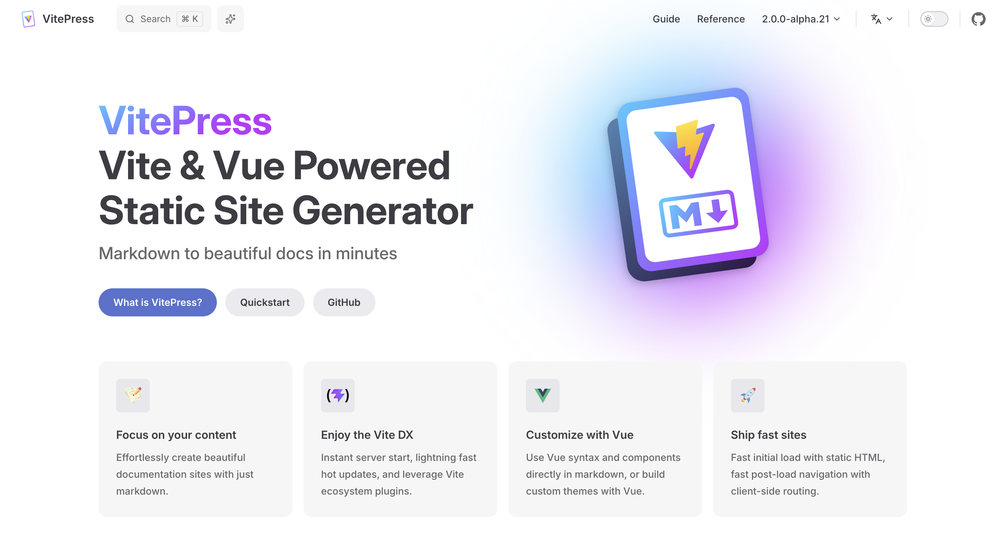
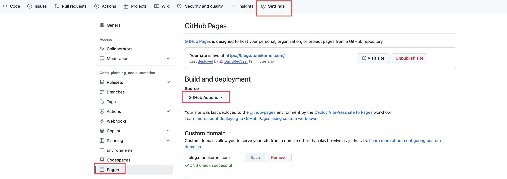
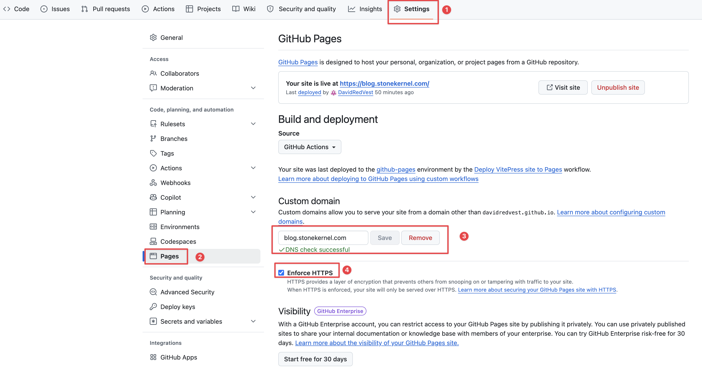

# vitepress博客搭建 

vitepress官方网站：https://vitepress.dev/

 

开发环境

- Macbook pro m4

## 部署  

### 1.环境准备 

打开Mac的终端，检查是否已经安装node.js（VitePress需要Node.js18及以上版本）

```bash
node -v
```

- 已经安装：如果输出版本号，直接进行下一步

- 未安装：推荐使用Homebrew安装，或从Node.js官网下载

  ```bash
  # 使用 Homebrew安装 Node.js 
  brew install node
  ```

### 2.创建并初始化项目 

```bash
# 创建项目目录并进入
mkdir my-docs
cd my-docs

# 初始化package.json
npm init -y

# 安装VitePress
# 如果出错下面有解决方案
npm add -D vitepress
```

在安装vitepress这一步会报错：

```bash
npm error code EACCES
npm error syscall mkdir
npm error path /Users/liszt/.npm/_cacache/index-v5/f5/47
npm error errno EACCES
npm error
npm error Your cache folder contains root-owned files, due to a bug in previous versions of npm which has since been addressed.
npm error
npm error To permanently fix this problem, please run:
npm error   sudo chown -R 501:20 "/Users/liszt/.npm"
npm error A complete log of this run can be found in: /Users/liszt/.npm/_logs/2026-11-25T04_10_04_376Z-debug-0.log
```

解决办法：

```bash
sudo chown -R 501:20 "/Users/liszt/.npm"
```

并输入密码确认，然后再次安装VitePress

```bash
# 运行配置向导
npx vitepress init
# 会出现交换选项，默认配置即可

# 启动本地预览
npm run docs:dev
# 终端会输出本地访问地址，通常是：http://localhost:5173/

```

### 3.目录结构与常用命令 

完成上述步骤后，项目基础结构如下：

```te
my-docs/
├── .vitepress/                 # VitePress 配置目录（macOS 访达中默认隐藏，按 Command+Shift+. 可显示）
│   └── config.mts              # 初始配置文件（如果你在向导中选择 TypeScript 为 No，则为 config.mjs）
├── api-examples.md             # 官方自带的 API 示例页面
├── index.md                    # 网站默认首页
├── markdown-examples.md        # 官方自带的 Markdown 扩展语法示例页面
├── node_modules/               # 依赖包目录（执行 npm add -D vitepress 时生成）
├── package-lock.json           # 依赖版本锁文件
└── package.json                # 项目配置与启动脚本文件
```

常用脚本命令（在项目根目录执行）：

- 启动开发预览：`npm run docs:dev`（支持热更新，修改`MarkDown`保存后网页实时刷新）
- 构建静态网页：`npm run docs:build`（生成用于部署的`HTML/CSS/JS`文件，默认输出在`docx/.vitepress/dist`）
- 本地预览构建产物：`npm run docs:preview`

本地环境搭建完成

## 静态网站托管 

将本地静态博客托管到`GitHub`网站

### 1.本地测试打包是否正常

在`my-docs`目录下打开终端，先运行一次打包命令，确保文档和图片路径没有报错

```bash
npm run docs:build
```

验证方式：终端提示`build complete`，且`.vitepress/dist`目录下生成了网页文件。

### 2.将项目上传到GitHub仓库 

在`GitHub`登录并创建一个仓库，例如`my-docs`。在根目录创建一个`.gitignore`文件，写入一下内容（避免把庞大的依赖和临时缓存传上去）：

```te
git init
git add .
git commit -m "first commit"
git branch -M main
git remote add origin <仓库地址>
git push -u origin main
```

刷新`GitHub`仓库页面，就可以看到上传的文件了。

### 3.添加自动化工作流文件 

#### 一.修改VitePress配置文件 

`GitHub Pages`默认的免费访问地址格式为`https://<你的用户名>.github.io/<你的仓库名>/`。因此必须告诉`VitePress`网站的二级目录名称，否则部署后样式和图片会加载失败。

打开`.vitepress/config.mts`文件，添加`base`配置项：

```typ
import { defineConfig } from 'vitepress'

export default defineConfig({
// 替换成你的 GitHub 仓库名，前后必须都有斜杠！
// 例如仓库叫 my-docs，这里就写 '/my-docs/'
base: '/my-docs/',

title: "My Awesome Project",
description: "A VitePress Site",
// ... 其他原有配置保持不变
})
```

> 注意：如果你的仓库名正好是<你的用户名>.github.io，则不需要加base这一行，或者写base:'/'

#### 二.创建GitHub Actions自动部署脚本 

在你的项目根目录(`my-docs`)下，依次新建层级文件夹`.github/workflows/`，并在里面创建一个名为`deploy.yml`的文件：

```te
my-docs/
├── .github/
│   └── workflows/
│       └── deploy.yml    <-- 新建这个文件
├── .vitepress/
├── index.md
└── package.json

```

将以下官方标准配置完整复制到`deploy.yml`中保存

```yam
name: Deploy VitePress site to Pages

on:
  # 每次推送到 main 分支时自动触发部署
  push:
    branches: [main]
  # 允许在 GitHub 网页端手动点击运行
  workflow_dispatch:

permissions:
  contents: read
  pages: write
  id-token: write

concurrency:
  group: pages
  cancel-in-progress: false

jobs:
  build:
    runs-on: ubuntu-latest
    steps:
      - name: Checkout
        uses: actions/checkout@v4
        with:
          fetch-depth: 0
      - name: Setup Node
        uses: actions/setup-node@v4
        with:
          node-version: 20
          cache: npm
      - name: Setup Pages
        uses: actions/configure-pages@v4
      - name: Install dependencies
        run: npm ci
      - name: Build with VitePress
        # 注意：因为你的文档在根目录，构建命令直接运行 docs:build
        run: npm run docs:build
      - name: Upload artifact
        uses: actions/upload-pages-artifact@v3
        with:
          # 构建产物在根目录下的 .vitepress/dist
          path: .vitepress/dist

  deploy:
    environment:
      name: github-pages
      url: ${{ steps.deployment.outputs.page_url }}
    needs: build
    runs-on: ubuntu-latest
    name: Deploy
    steps:
      - name: Deploy to GitHub Pages
        id: deployment
        uses: actions/deploy-pages@v4

```

> 注意：使用git branch查看本地分支是main还是master，确保  push:
>     branches: [main]是正确的

#### 三.开启GitHub仓库的Pages功能 

1.将修改后的代码推送到`GitHub`仓库：

```bash
git add .
git commit -m "add github pages deploy workflow"
git push
```

2.打开游览器进入你的`Github`仓库页面，点击顶部的`Settings`

3.在左侧菜单栏找到并点击`Pages`

4.在`Build and deployment`下的`Source`下拉框中，将默认的`Deploy from a branch`改为`GitHub Actions`



#### 四.查看部署进度与外网网址 

1.切换到仓库顶部的`Actions`标签页，能看到`Deploy VitePress site to Pages`正在运行（黄色旋转图标）

2.等待1分钟后图标变成绿色对勾，在次回到`Settings->Pages`，页面会显示访问外网链接（如`https://<你的用户名>.github.io/my-docs/`）.


### 4.添加域名 

在`GitHub Pages`绑定二级域名，如`blog.stonekernel.com`，需要在域名解析商处添加`CNAME`记录，并在`Github`仓库和`VitePress`配置中同步更新路径。

#### 一.修改VitePress的base配置

绑定独立域名之后，你的网站访问路径从`https://<用户名>.github.io/<仓库名>/` 变成了根目录`https://blog.stonekernel.com` .必须把之前设置的二级目录前缀改回（直接删掉base这一行），否则绑定域名后页面样式和图标全部404丢失。

打开`.vitepress/config.mts`文件：

```type
import { defineConfig } from 'vitepress'

export default defineConfig({
  // 改成 '/' 或者直接删除这一行！不要再写 '/仓库名/'
  base: '/', 
  
  title: "My Awesome Project",
  description: "A VitePress Site",
  // ... 其他配置保持不变
})

```

#### 二.在域名服务商处添加DNS解析记录 

进入DNS解析管理页面，添加一条`CNAME`记录：

| 记录类型 | 主机记录 | 记录值                       | TTL  |
| -------- | -------- | ---------------------------- | ---- |
| CNAME    | blog     | <你的GitHub用户名>.github.io | 自动 |

- 注意：记录值末尾不要加`https://`，也不要加`/仓库名`，只填写纯域名
- 如果使用的`Cloudflare`解析，建议先将代理状态（小云朵图标）设置为仅DNS（灰色），等`GitHub SSL`证书签发成功后在决定是否开启橙色代理。

#### 三.在GitHub仓库中绑定域名并开启HTTPS 

- 先将修改的`vitepress`配置文件提交到`Github`

  ```bash
  git add .
  git commit -m "chore: reset base path for custom domain"
  git push
  ```

- 在仓库`Pages`设置中填入域名

  打开`GitHub`仓库页面，找到`Settings->Pages`页面，找到`Custom domain`输入框，填入：`blog.stonekernel.com`，点击保存。`GitHub`会自动检查你的DNS解析，当下方出现绿色的`DNS check successful`提示时，说明解析已生效。

- 强制开启HTTPS安全证书

  DNS检查通过落后，等待几分钟，等下方`Enforce HTTPS`复选框变成可点击状态时，勾选它。`GitHub`会自动为`blog.stonekernel.com`签发免费的`Let's Encrypt SSL`证书。

 

至此，基础页面已经完成，但是新的文章还无法通过菜单直接跳转，需要继续优化。


## 配置config.mts文件

- 配置顶部导航栏与左侧边栏
- 开启本地全文搜索
- 开启简洁URL（去掉网址末尾的.html）
- 配置页面最后更新时间
- 为技术笔记增加图片点击放大灯箱
- 增加顶部导航栏右上角邮箱图标
- 首页页脚全局显示

```javascript
import { defineConfig } from 'vitepress'

// https://vitepress.dev/reference/site-config
export default defineConfig({
  //add github projece name
  //use domain delete base
  //base:'/MY_DOCS/',

  //开启简洁URL 
  cleanUrls:true,
  //配置页面最后更新时间
  lastUpdated:true,
  title: "StoneKernel技术博客",
  description: "嵌入式系统开发记录",
  lang: 'zh-CN', // 将默认界面提示语（如“上一页/下一页”、“本页目录”）切换为中文
  themeConfig: {
    // https://vitepress.dev/reference/default-theme-config
    //1.顶部导航栏
    nav: [
      { text: '首页', link: '/' },
      { text: '嵌入式与底层系统', link: '/embedded/embedded',activeMatch: '/embedded/' },
      { text: '系统架构与中间件', link: '/architecture/architecture',activeMatch: '/architecture/' },
      { text: '跨平台与工具链', link: '/tooling/tooling',activeMatch: '/tooling/' },
      { text: '阅读与随笔', link: '/notes/notes',activeMatch: '/notes/' },
      { text: '越野与山野', link: '/outdoors/outdoors',activeMatch: '/outdoors/'  }
    ],
    //2.左侧边栏（支持多专栏独立分组，以后文章多了可按照目录拆分）
    // sidebar:[],使用数组表示全局共享
    sidebar: {
      // 当URL以/embedded/开头时，只显示这一组
      '/embedded/': [
        {
          text: '嵌入式与底层系统',
          items: [
            {text: '专栏导读', link: '/embedded/embedded'},
            {text: 'threadx移植实战', link:'/embedded/ThreadX移植实战1/threadx移植实战1'}
          ]
        }
      ],

      '/architecture/': [
        {
          text: '系统架构与中间件',
          items: [
            { text: '专栏导读', link: '/architecture/architecture' }
          ]
        }
      ],      

      //当URL以/tooling/开头时，只显示这一组
      '/tooling/': [
        {
          text: '跨平台与工具链',
          items: [
            { text: '专栏导读', link: '/tooling/tooling' },
            { text: 'vitepress博客搭建', link: '/tooling/vitepress博客搭建/vitepress博客搭建' }
          ]
        }
      ],

      '/notes/': [
        {
          text: '阅读与随笔',
          items: [
            { text: '专栏导读', link: '/notes/notes' }
          ]
        }
      ],
      
      '/outdoors/': [
        {
          text: '越野与山野',
          items: [
            { text: '专栏导读', link: '/outdoors/outdoors' }
          ]
        }
      ]      

    },


    //3.右侧页内大纲显示级别
    outline:{
      level:'deep',
      label:'本页目录'
    },

    //4.底部翻页按钮文字汉化
    docFooter:{
      prev:'上一篇',
      next:'下一篇'
    },

//    socialLinks: [
//      { icon: 'github', link: 'https://github.com/vuejs/vitepress' }
//    ]

    //开启全文本地搜索
    search: {
      provider: 'local',
      options: {
        translations: {
          button: { buttonText: '搜索笔记', buttonAriaLabel: '搜索笔记' },
          modal: {
            noResultsText: '无法找到相关内容',
            resetButtonTitle: '清除查询条件',
            footer: { selectText: '选择', navigateText: '切换' }
          }
        }
      }
    },

    //配置页面最后更新时间
    lastUpdated:{
      text:'最后更新于',
      formatOptions:{dateStyle:'short',timeStyle:'short'}
    },

    //右上角社交/联系图标，内置邮件信封图标
    socialLinks: [
      {
        icon: {
          svg: '<svg xmlns="http://www.w3.org/2000/svg" viewBox="0 0 24 24" fill="currentColor"><path d="M1.5 8.67v8.58a3 3 0 0 0 3 3h15a3 3 0 0 0 3-3V8.67l-8.928 5.493a3 3 0 0 1-3.144 0L1.5 8.67Z"/><path d="M22.5 6.908V6.75a3 3 0 0 0-3-3h-15a3 3 0 0 0-3 3v.158l9.714 5.978a1.5 1.5 0 0 0 1.572 0L22.5 6.908Z"/></svg>'
        },
        link: 'mailto:me@stonekernel.com',
        ariaLabel: '发送邮件至 me@stonekernel.com'
      }
    ],

    //首页底部显示邮箱联系方式
    footer: {
      message: '欢迎技术交流与探讨：<a href="mailto:me@stonekernel.com">me@stonekernel.com</a>',
      copyright: 'Copyright © 2026 StoneKernel'
    }    


  }
})

```

